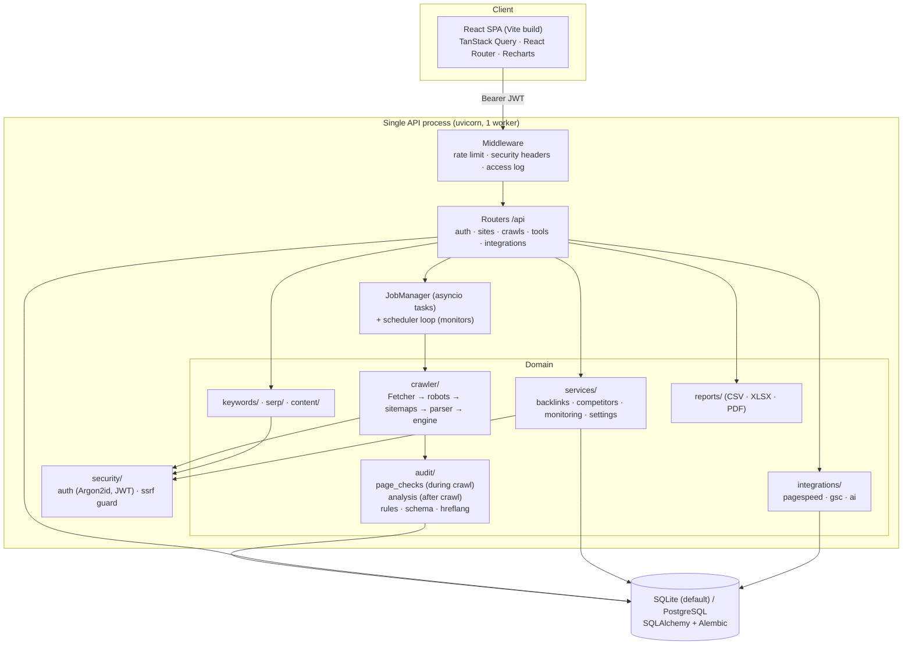
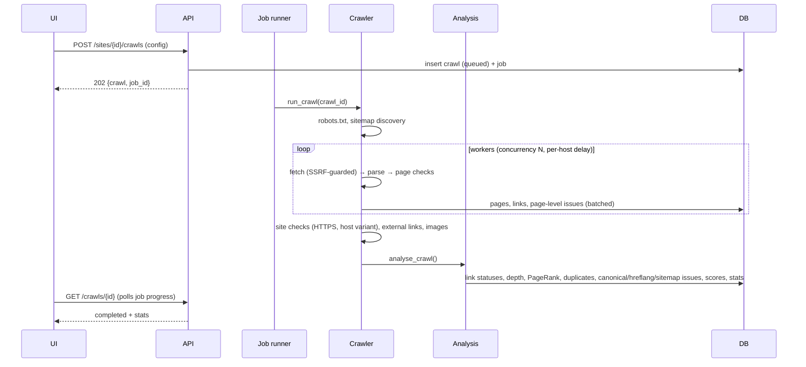
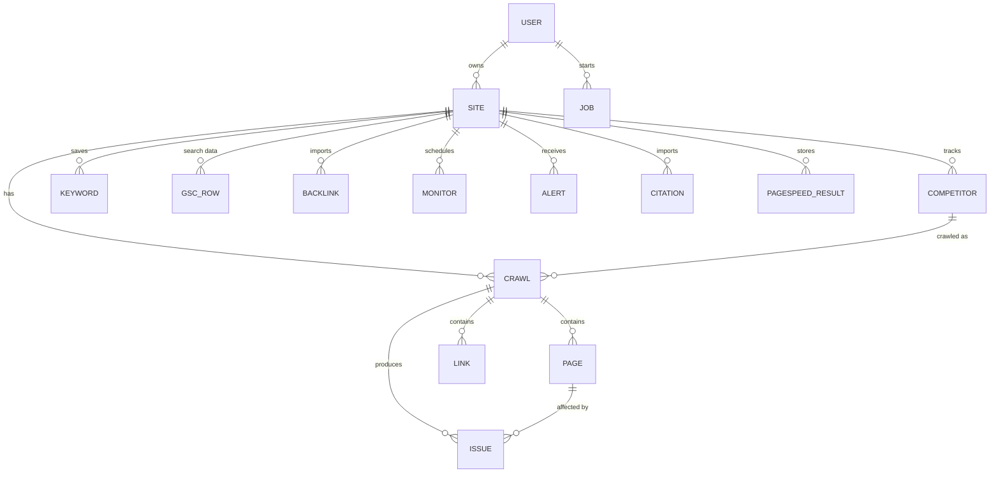

# Architecture

The rationale for each choice is in `../ARCHITECTURE_DECISIONS.md`. This document describes how the pieces fit together.

## Runtime view

## Crawl sequence

## Data model

| Table | Notes |
|---|---|
| `pages` | One row per crawled URL, including redirects, errors and robots-blocked URLs. Scalar SEO fields are columns; variable data (headings, images, Open Graph, JSON-LD, hreflang) is JSON in `data`; extracted body text is a deferred column. |
| `links` | Every `<a>` link with anchor, rel, internal flag and the resolved target status. |
| `issues` | `(crawl, page?, rule_id, severity, category, details)`. `page_id` is null for site-wide rules. |
| `crawls.stats` | JSON summary written by the analysis (status classes, depth distribution, issue counts, sitemap report, site checks ...). |
| `settings` | Instance-wide integration settings and per-user OAuth tokens. |

## Request security path

Every user-supplied URL goes through `api.deps.checked_url` (syntactic policy) and is fetched only via `crawler.fetcher.Fetcher`, whose
connection pool uses `security.ssrf.SafeNetworkBackend` (address policy at connect time). See `../SECURITY.md`.

## Frontend structure

- `lib/api.ts` — fetch wrapper (token, errors, downloads, uploads)
- `lib/context.tsx` — auth, selected site, theme, job polling
- `components/ui.tsx` — the UI kit all pages use (tables, pagination, cards, badges, modals, states)
- `components/Layout.tsx` — navigation shell
- `pages/*` — one file per screen, lazy-loaded

## Extending

| To add | Touch |
|---|---|
| An audit rule | `audit/rules.py` + `audit/page_checks.py` or `audit/analysis.py` + fixture/test |
| A SERP provider | `serp/analyzer.py::search` + `services/settings_store.py` defaults + Settings page |
| An AI task | `integrations/ai.py::TASKS` + context builder in `api/integrations.py::ai_run` |
| A monitor kind | `services/monitoring.py` (`KINDS`, `run_monitor`) + Monitoring page form |
| A queue backend | implement the `JobManager` interface in `jobs.py` |
